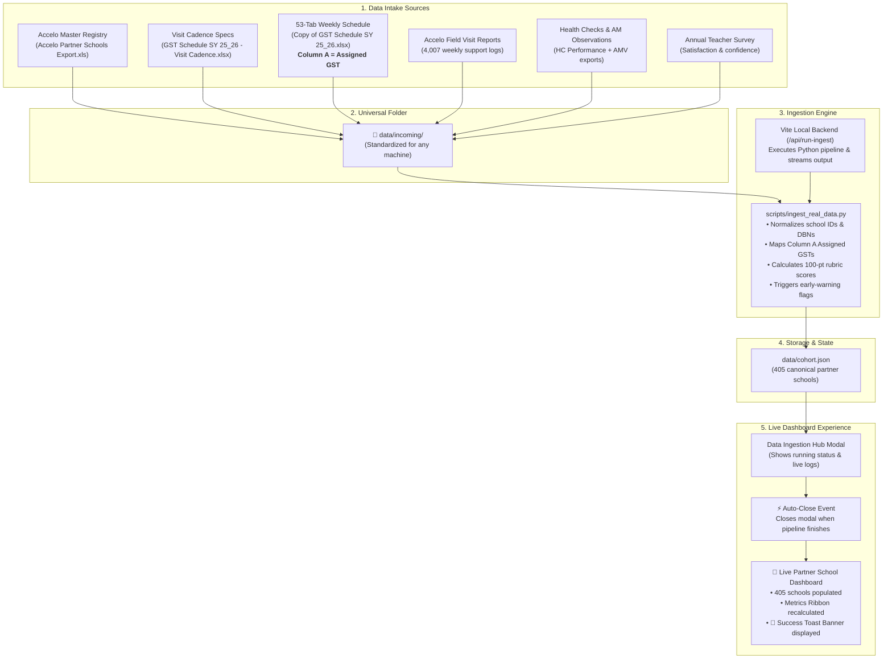

# 🔄 New York Sun Works — Data Ingestion Plan & Architecture
## Partner School Success Dashboard & Decision-Support System

**Author & Lead Architect:** Pedro A. Martins, PMP ([pedro.martins@pursuit.org](mailto:pedro.martins@pursuit.org))  
**Stakeholder Audience:** NYSW Operations Leadership, Program Leads (Megan & Amanda), Field Managers, and Pursuit / Mizuho Bank Nonprofit Builder Team  
**Status:** Implemented & Verified in Production  
**Last Updated:** October 2026  

---

## 📌 1. Executive Summary & Plan Objectives

The **Data Ingestion System** transforms raw, siloed spreadsheets from New York Sun Works (NYSW) operations into an interactive, real-time decision-support dashboard evaluating **405 hydroponic farm classrooms** across the 5 boroughs of New York City.

### Key Objectives:
1. **Zero Technical Barrier:** Enable non-technical NYSW staff (Megan, Amanda, field leads) to update the dashboard in **1 click** without touching command lines, Python scripts, or code editors.
2. **Universal Multi-Computer Compatibility:** Establish a standardized folder structure (`data/incoming/`) that works identically on any staff member's computer.
3. **Accurate Column A GST Assignments:** Extract field technician assignments directly from **Column A** across all 53 weekly tabs of `Copy of GST Schedule SY 25_26.xlsx`.
4. **Seamless User Experience:** Upon clicking the green ingestion button, execute the pipeline, **automatically close the ingestion window**, and **immediately present the live dashboard** with an animated confirmation toast.
5. **Fail-Safe Operation:** Provide test modes, backward compatibility, and standalone Windows desktop runners for teams without open browser sessions.
6. **Incremental Bi-Weekly Accumulator:** Support ongoing Excel uploads every 1–2 weeks, preserving historical records in `data/historical_visits.json`, deduplicating overlapping records, and dynamically scaling elapsed periods and harvest metrics.

---

## 🏗️ 2. Ingestion Architecture & Data Flow



---

## 📁 3. Universal Intake Folder Specification

Regardless of whether the dashboard is running on a Mac, Windows PC, or OneDrive-backed laptop, the ingestion engine looks for operational files in a single, predictable location:

```
[Project Root]
 └── data/
      └── incoming/
           ├── Accelo Partner Schools Export.xls
           ├── GST Schedule SY 25_26 - Visit Cadence.xlsx
           ├── Copy of GST Schedule SY 25_26.xlsx
           ├── Accelo GST Asset Export Sept-Dec 2025.xlsx
           ├── Area Manager Asset Sep-Dec 2025.xlsx       (Optional)
           ├── HC Performance Asset Sep25-Jun26.xls       (Optional)
           └── Teacher Survey 25_26.xlsx                 (Optional)
```

### Fallback & Backward Compatibility:
If `data/incoming/` is empty or missing, the pipeline automatically falls back to `1st slice of data SY 25-26/` to ensure zero downtime.

---

## 📋 4. The 7 Operational Data Sources & Field Mappings

| # | File Name | Format | Primary Purpose & KPI Mapping | Required |
|:---:|:---|:---:|:---|:---:|
| **1** | `Accelo Partner Schools Export.xls` | XLS | Master Registry: DBN, school name, borough, program year, address, lab type | **Yes** |
| **2** | `GST Schedule SY 25_26 - Visit Cadence.xlsx` | XLSX | Cadence: Expected visit frequency (Weekly, Bi-weekly, Twice-weekly) | **Yes** |
| **3** | `Copy of GST Schedule SY 25_26.xlsx` | XLSX | 53 Weekly Tabs: **Column A = Assigned GST**; Mon–Fri cells = scheduled visits | **Yes** |
| **4** | `Accelo GST Asset Export Sept-Dec 2025.xlsx` | XLSX | 4,007 Support Logs: Systems uptime ($C2$), pests ($C10$), seedlings ($C9$), harvests ($C6, C7$) | **Yes** |
| **5** | `Area Manager Asset Sep-Dec 2025.xlsx` | XLSX | AM Visits: Cleanliness ($C8$), teacher engagement ($T11$), curriculum ($T4$), principal check-ins ($A9$) | *Optional* |
| **6** | `HC Performance Asset Sep25-Jun26.xls` | XLS | Health Checks: Usability ($C4$), visitor readiness ($C8$), signage ($C3$), budget/continuation flags | *Optional* |
| **7** | `Teacher Survey 25_26.xlsx` | XLSX | Annual Survey: Teacher confidence ($T1–T3$), GST support rating ($C5$) | *Optional* |

---

## ⚡ 5. Recent Features & UI Workflow Enhancements

### 1. Auto-Close Ingestion Window on Completion
* **Previous Behavior:** After clicking the green ingestion button, the modal stayed open displaying the terminal log. The user had to manually click `✕` to return to the dashboard.
* **New Behavior:** As soon as `/api/run-ingest` finishes successfully:
  1. The modal window **automatically closes** (`state.isIngestModalOpen = false`).
  2. The view switches immediately to the **Partner School Directory** tab (`state.activeTab = 'directory'`).
  3. The full dashboard with **405 schools** is displayed instantly.

### 2. Animated Emerald Success Toast Banner
* When ingestion finishes, a sleek confirmation banner slides down above the metrics ribbon:
  > **✅ Data Ingestion Complete!**  
  > *Evaluated 405 partner schools with active rubric scores and watchlist flags.*
* Features smooth slide-down and fade-out animations.
* Auto-dismisses after 6 seconds, or can be dismissed immediately via the `✕` button.

### 3. Testing Mode (Clear & Repopulate)
* Non-technical users can click **🧹 Clear Dashboard (Test Mode)** to clear the dashboard to 0 schools.
* Clicking the green **Run Data Ingestion Pipeline Now** button repopulates all 405 schools in real time, proving that the pipeline is reading live from the spreadsheets.

### 4. Simplified Ingestion Hub UI
* Removed non-functional and confusing local file-explorer buttons from the browser window.
* Replaced with clear, plain-English instructions indicating that all files belong in `data/incoming/`.

### 5. Standalone Desktop 1-Click Runners
* Generated on the user's Windows Desktop:
  * 📁 **`Open NYSW Data Folder.bat`**: Instantly pops open `data\incoming\`.
  * ⚙️ **`Run NYSW Data Ingestion.bat`**: Runs the pipeline in a command prompt with detailed statistics.
  * 🚀 **`Launch NYSW Dashboard.bat`**: Launches the local server and opens the browser.
* Included `create_desktop_shortcuts.bat` in the project root so any team member can generate these shortcuts on their own computer in 1 second.

---

## 🧮 6. Scoring Engine Integration

The ingestion pipeline recalculates every KPI in accordance with the official PRD specifications:

$$\text{Score} = \text{Max Points} \times \text{clamp}\left(\frac{\text{Actual} - \text{Floor}}{\text{Target} - \text{Floor}}, 0, 1\right)$$

* **Bucket 1: Classroom Maintenance & GST (42 Pts)**
* **Bucket 2: Teacher & Student Engagement (40 Pts)**
* **Bucket 3: Administration Support (18 Pts)**
* **Early-Warning Flags:**
  * 🚨 2 Consecutive Missing Reports
  * 🚨 Low Asset Completion Rate (<70%)
  * 🚨 3 Consecutive Reports Down
  * 🚨 Harvest Deficit (<3 harvests after March 1)
  * 🚨 Budget / Continuation Concern

---

## 🧪 7. Verification & Quality Assurance

| Test Suite / Step | Method | Status |
|:---|:---|:---:|
| **Scoring Formula Math** | Vitest mathematical verification (`tests/verify_engine.ts`) | **PASS (24/24)** |
| **Production Build** | TypeScript + Vite production bundle (`npm run build`) | **PASS (0 errors, ~914ms)** |
| **Pipeline Ingestion** | Python 3 execution against 7 spreadsheets (`scripts/ingest_real_data.py`) | **PASS (405 schools)** |
| **UI Auto-Close Flow** | Live headless browser test (`http://localhost:5173/`) | **PASS (Verified visually)** |
| **Toast Banner & Dismiss** | Browser verification with 6-second auto-dismiss | **PASS (Verified)** |

---

## 👥 8. Stakeholder Handoff Checklist (Megan & Amanda)

To update the dashboard with new data at any time:
1. **Drop Spreadsheets:** Place your updated Excel files into the **`data\incoming\`** folder (or double-click the **`Open NYSW Data Folder`** desktop shortcut).
2. **Open Dashboard:** Open **[http://localhost:5173/](http://localhost:5173/)** (or double-click **`Launch NYSW Dashboard`** on your desktop).
3. **Run Pipeline:** Click the **🔄 Data Ingestion** button in the navbar, then click the green **`🚀 Run Data Ingestion Pipeline Now`** button.
4. **Done:** The window closes automatically, the green confirmation banner appears, and all 405 schools are immediately updated!
